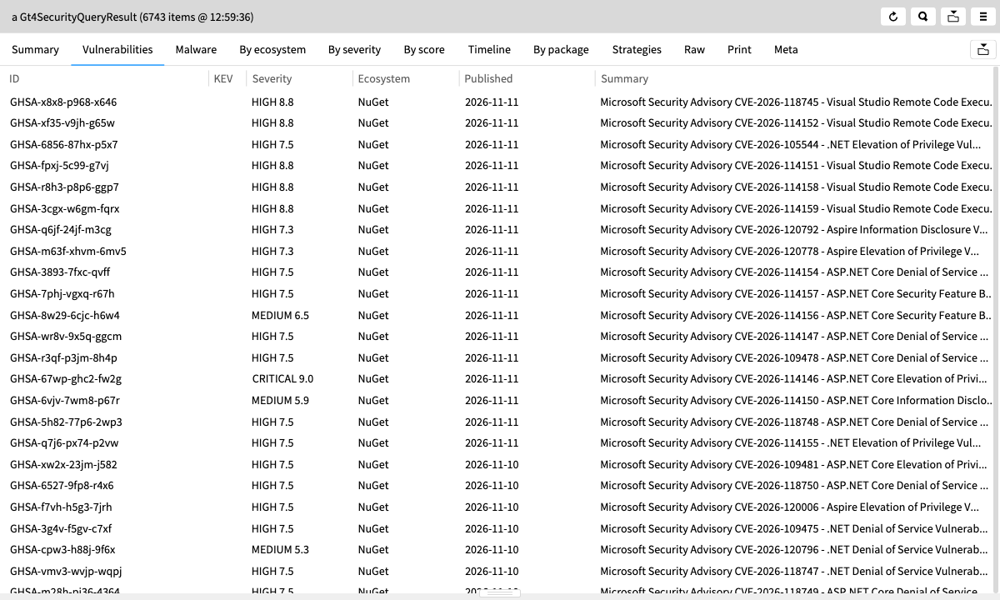
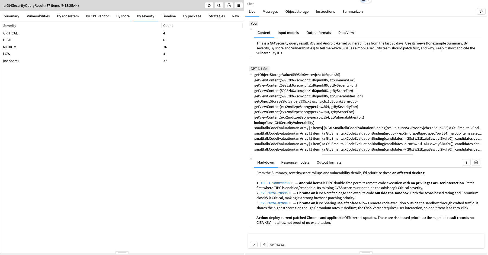
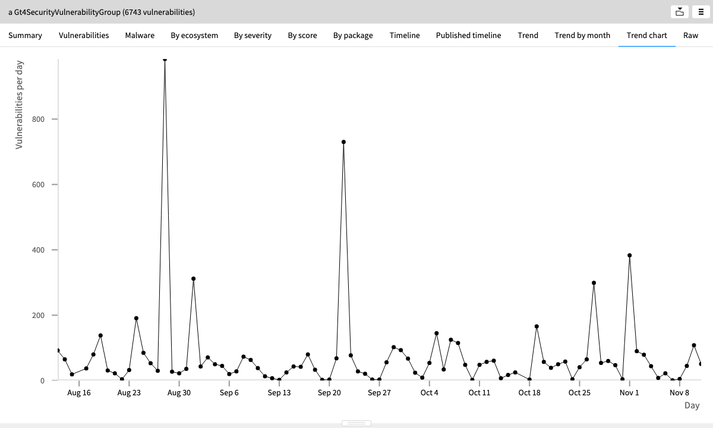
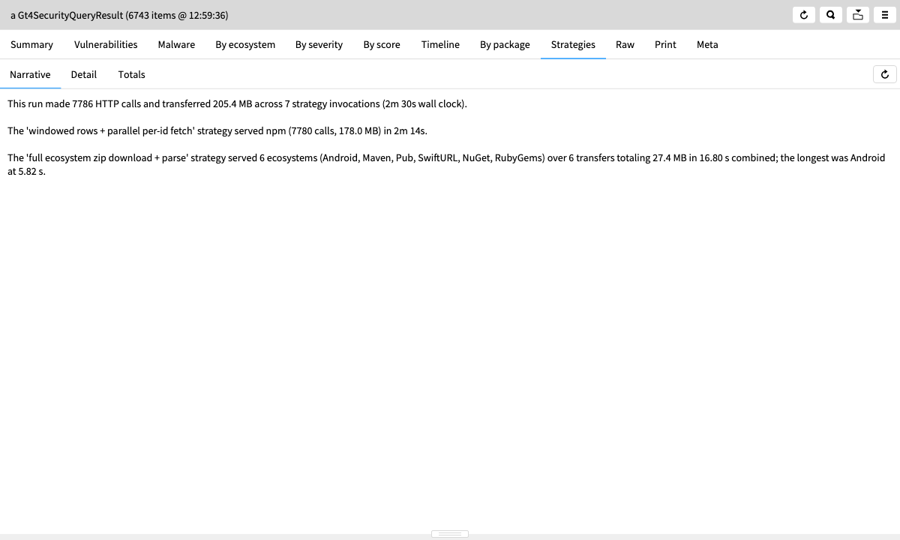
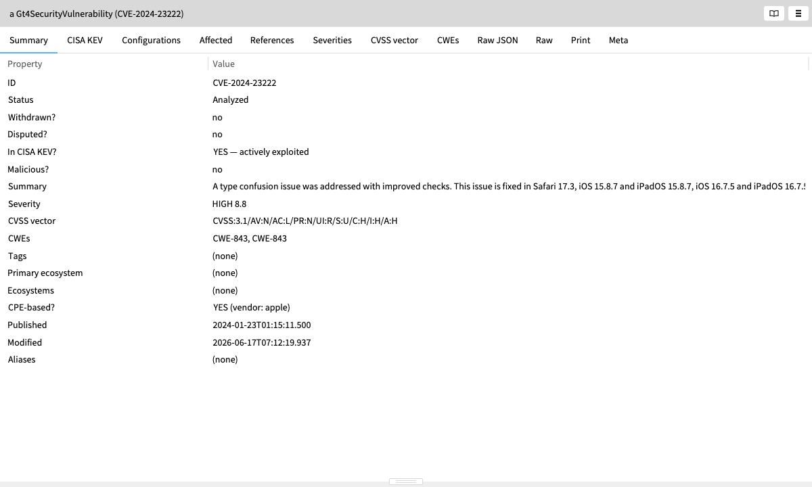
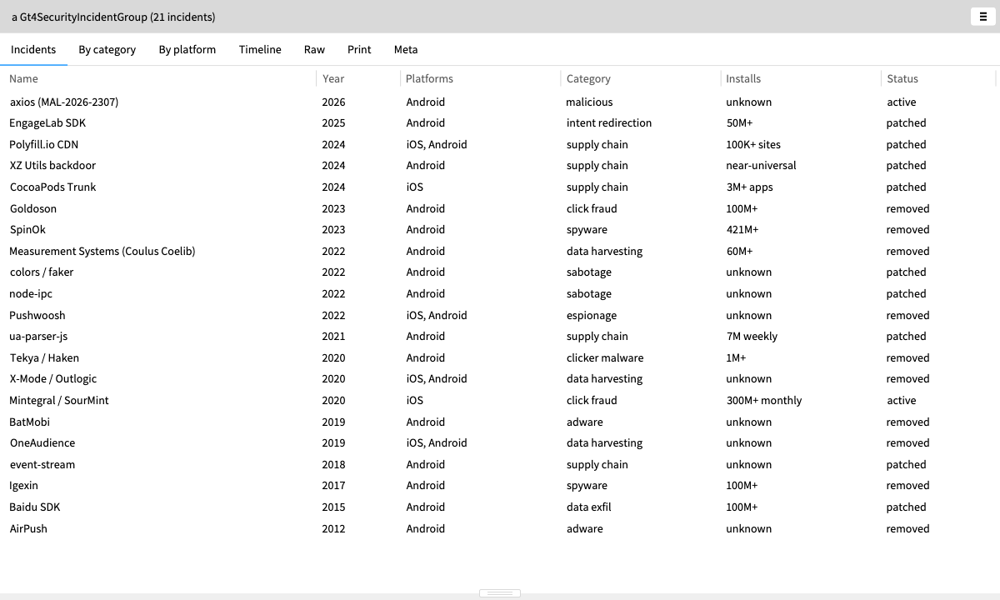
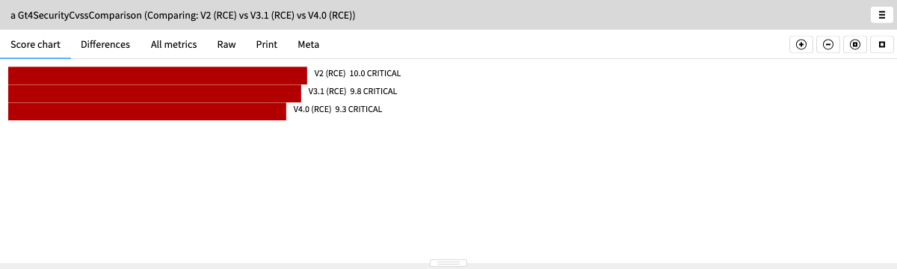

# Gt4Security

Moldable vulnerability intelligence for [Glamorous Toolkit](https://gtoolkit.com).
Gt4Security pulls CVEs, advisories and malicious-package reports from free public
sources and turns them into live domain objects that you can query, filter, chart
and drill into from the GT inspector. Its focus is the mobile ecosystem: iOS,
Android, and the libraries bundled into mobile apps.



## What you can do with it

- **Ask one question across sources.** `Gt4SecurityQuery` fans out to NVD (CPE
  based: iOS, firmware, native libraries) and OSV (package based: npm, Maven,
  Pub, SwiftURL, Android, …). It merges the results and removes duplicates by
  ID and alias. The result records where each record came from, how many were
  filtered or deduplicated, and how long the run took.
- **Scan whole ecosystems in bulk.** Add an ecosystem with `feedEcosystem:`
  and the query reads it from the OSV bulk feed instead of the per-package API.
  A strategy selector ranks six ways to fetch each ecosystem by cost: cached
  CSV window, streamed CSV window, hydrated window, zip lookup, single ID, and
  the full ecosystem zip. A narrative then explains what the run did and what
  it cost.
- **Triage a result set.** Every vulnerability group has views by severity, score,
  ecosystem, package and CPE vendor, plus malware, CISA KEV, timeline and trend
  views. Filters such as `highSeverity`, `malicious`, `inKev`, `ecosystem:` and
  `matching:` return another group, so you can chain them and keep every view.
- **Drill into one advisory.** A vulnerability shows its affected packages and
  version ranges, NVD CPE configurations, references, aliases, CWEs, credits,
  fixes, GitHub advisory metadata, CISA KEV status, and the raw JSON.
- **Spot malicious packages.** OSSF Malicious Packages reports (`MAL-*`) appear
  next to ordinary CVEs, with their origin reports attached.
- **Compare CVSS scores.** The package includes a calculator for CVSS v2, v3.0,
  v3.1 and v4.0, and a side-by-side comparison that highlights which metrics
  differ.
- **Track threats that have no CVE.** A curated catalog of 21 mobile incidents
  (`Gt4SecurityIncidentExamples>>#catalog`) covers events that never got a CVE:
  espionage and spyware SDKs, click fraud, data harvesting, and supply-chain
  compromises.
- **Export.** Any result can be exported to CSV.

## A quick tour

Build a query, inspect it, and press the **▶ Run query** button. You can also run it directly:

```smalltalk
Gt4SecurityQuery new
    ios;
    androidPackage: ':linux_kernel:';
    package: 'com.squareup.okhttp3:okhttp' ecosystem: 'Maven';
    publishedSince: Date today - 90 days;
    severityAtLeast: 7.0;
    run.
```

Scan the bulk feed for every mobile-relevant ecosystem:

```smalltalk
| query |
query := Gt4SecurityQuery new.
Gt4SecurityOsvFeedClient mobileEcosystems do: [ :eco | query feedEcosystem: eco ].
query publishedSince: Date today - 90 days.
query run.
```

Chain filters and keep the views:

```smalltalk
((Gt4SecurityNvdClient new latestIosCvesSince: Date today - 60 days)
    highSeverity)
    matching: 'kernel'.
```

## Ask an AI about the data

Glamorous Toolkit's built-in LLM chat ("Chat about this object" in the
inspector) works on Gt4Security objects. The model reads the same custom views
you use, such as Summary, By severity, By score and Vulnerabilities. It can also
evaluate code against the vulnerability objects to check its reasoning. Its
answer links back to the live objects, so you can click any cited ID to inspect
it.



## More views

| | |
|---|---|
|  **Trend chart:** vulnerabilities per day across 6,700+ advisories. |  **Strategies:** how the bulk feed was fetched, with call counts, bytes and time. |
|  **A single CVE:** CVE-2024-23222 from NVD, flagged as actively exploited in CISA KEV. |  **Incidents without CVEs:** espionage SDKs, click fraud and supply-chain attacks. |



## Data sources

| Source | Used for |
|---|---|
| [OSV.dev API](https://osv.dev) | Package lookups (npm, Maven, Pub, SwiftURL, Android, PyPI, crates.io, …), and OSSF malicious-package reports. |
| [OSV bulk feed](https://google.github.io/osv.dev/data/#data-dumps) | Whole-ecosystem and time-window scans. It is cached on disk and revalidated with conditional requests. |
| [NVD API v2](https://nvd.nist.gov/developers/vulnerabilities) | CPE-based lookups for any CPE via `cpe:`, for example iOS (which has an `ios` shortcut), device firmware, and native libraries such as OpenSSL. It also supplies CISA KEV data. |

None of these need authentication. NVD allows 5 requests per 30 seconds
without an API key. With a [free key](https://nvd.nist.gov/developers/request-an-api-key)
the limit rises to 50, and you can use the key with
`Gt4SecurityNvdClient withApiKey: '…'`.
Large ZIP64 feed archives are read through the system `unzip`.

## Installation

```smalltalk
Metacello new
    baseline: 'Gt4Security';
    repository: 'github://dweinstein/gt4security:main/src';
    load.

"Optional: register the project's Lepiter pages (demo, architecture, notes)."
BaselineOfGt4Security loadLepiter.
```

Start with the **Gt4Security — Demo** Lepiter page, or browse the `<gtExample>`
methods in the `*Examples` classes. Examples marked `<noTest>` call the live
APIs; the rest run offline.

## Layout

```
src/BaselineOfGt4Security/   Metacello baseline and Lepiter loader
src/Gt4Security/             Clients, queries, feed strategies, domain objects and views
lepiter/                     Project Lepiter database (demo, architecture, design notes)
docs/images/                 README screenshots
```
